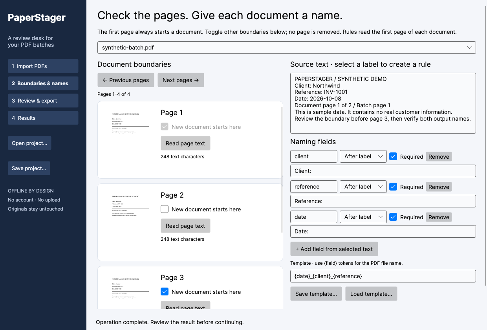

# PaperStager

**Review a batch of PDFs that already have selectable text, split it into documents, and give every file a verified name.**

PaperStager is a free, open-source desktop app for macOS, Windows and Linux. Paid Windows tools such as ScanRoute Local (Microsoft Store) and AutoSplit (needs Adobe Acrobat) already split and name batches. PaperStager does the review-before-filing part for free, on all three systems, with every step visible. Page thumbnails help you mark document boundaries, text rules suggest naming fields, and a review desk catches missing fields, invalid names and duplicate paths before you approve an export.

**PaperStager has no OCR.** Naming rules read the text layer that is already in the PDF. Most office scanners produce image-only PDFs: run them through a tool that adds a text layer first (for example [NAPS2](https://www.naps2.com/), or your scanner's "searchable PDF" setting), or type the naming fields by hand on the review screen.



## Get started

Download the portable package for your operating system from [Releases](https://github.com/rad1092/paperstager/releases). Extract it into an ordinary folder. On macOS open `PaperStager.app`, on Windows `PaperStager.exe`, and on Linux run `./PaperStager`. Packages include the .NET runtime. Linux needs an X11 desktop and `libx11-6 libice6 libsm6 libfontconfig1`; CI tests Ubuntu.

Starting with **0.1.1**, the macOS bundle has an ad-hoc signature checked for integrity after packaging. This fixes the invalid bundle signature in 0.1.0. Ad-hoc signing does not establish a trusted developer identity: there is **no macOS Developer ID signature or Apple notarization**, and the Windows package has **no Authenticode signature**. OS or organization policies may block launch. There is no installer, automatic updater or security-settings bypass. See the [verification record](docs/VERIFICATION.md) for release-specific evidence.

Use **Try a synthetic example** to inspect two fictitious documents, including a rotated page. No real invoices or personal data are included.

Follow [the first-batch walkthrough](docs/FIRST-RUN.md) to confirm four page
previews become two exported documents and a manifest before using your own PDFs.

1. **Import PDFs** by dropping them into the window or choosing files.
2. **Boundaries & names:** check the first page of every document. Select text and add label/regex naming rules, or add rules directly. Use a template such as `{date}_{client}_{reference}`.
3. **Review & export:** correct extracted fields or skip documents with a reason; the proposed names update as you type. Check the approval box, then choose an output folder.
4. **Results:** the new batch folder contains ordinary PDF files and `manifest.json`, mapping original source hashes and page ranges to output hashes and names.

[한국어 빠른 시작](docs/QUICKSTART.ko.md) · [Privacy and offline policy](docs/PRIVACY.md) · [Limitations](docs/LIMITATIONS.md) · [Research and alternatives](docs/RESEARCH.md)

## What makes it useful

- Standalone, open-source workflow across three desktop operating systems.
- Text-layer PDFs first: the text already in the PDF is reused instead of making another OCR guess.
- Multiple independent label or regex fields, reusable templates, editable values and Unicode names.
- Review and explicit approval; no background folder watchers or unattended export.
- Originals are only read. Existing output is never overwritten. A fresh batch folder is promoted only after staging completes.
- Failed or cancelled export leaves a clearly named recovery folder and progress journal where possible. Retry from the saved project after inspecting the journal.
- Save/open projects and templates as readable JSON. Approval is never saved.

PaperStager is not a scanner, OCR engine, document-management system or PDF annotation migration utility. No OCR or LLM runs inside this release. PDFs with annotations, form fields, layers or actions are rejected before page copying; flatten them first (see [Limitations](docs/LIMITATIONS.md#pdf-structure-safety-boundary)).

## Build and verify

Install the official .NET SDK 10.0.401 (`global.json` pins it, so the lock files match CI), then:

```sh
dotnet restore PaperStager.slnx --locked-mode
dotnet build PaperStager.slnx -c Release --no-restore
dotnet test PaperStager.slnx -c Release --no-build
dotnet run --project src/PaperStager.App -- --demo
```

The core and GUI are C#. PDF rendering uses PDFium, text extraction uses PdfPig, and page copying uses PDFsharp. No commercial SDK or NAPS2 application code is embedded. Unsupported PDF structures (including annotations, forms, layers/actions and non-default page scaling) are rejected before page copying; see the explicit [support boundary](docs/LIMITATIONS.md#pdf-structure-safety-boundary). See [third-party notices](THIRD-PARTY-NOTICES.md).

The CI workflow builds and tests on macOS, Windows and Linux, creates self-contained archives, extracts them and runs the actual native window through import, thumbnails, project/template round trips and export **twice** to check restart. [Verification record](docs/VERIFICATION.md) distinguishes native checks from headless tests and untested limitations.

## Contributing

Keep changes focused. Use synthetic fixtures, retain originals, and test failure and cancellation paths. Read [CONTRIBUTING.md](CONTRIBUTING.md) and [the product specification](docs/SPEC.md). Report issues without attaching private PDFs; a reduced synthetic reproduction is ideal.

MIT licensed. Dependency licenses remain their respective licenses.
